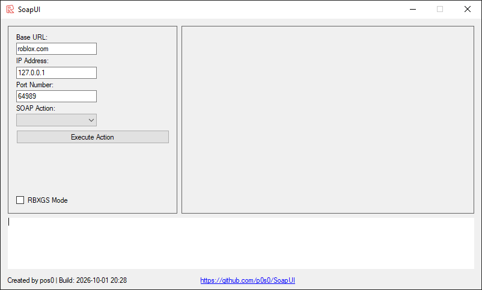

# SoapUI

SoapUI is a Windows Forms client for RCCService and RBXGS SOAP services. Configure a service endpoint, choose an action, run Lua scripts, and inspect the response without building SOAP envelopes by hand.



## Features

- Call RCC and RBXGS service actions, including job and environment management.
- Execute Lua scripts and add typed `LUA_T*` arguments.
- Import and export arguments as JSON; XML files are also supported for import.
- Load `.lua` and `.txt` scripts into the editor.
- Review structured results and service output in the log window.

## Requirements

- Windows 10 or 11
- Visual Studio 2019 or 2022 with the .NET desktop workload
- .NET Framework 4.7.2 targeting pack
- NuGet package restore (`Newtonsoft.Json` 13.0.4)

## Build and run

Clone the repository, restore packages, then build from a Visual Studio Developer PowerShell:

```powershell
git clone https://github.com/qu0s/SoapUI-Rewritten.git
cd SoapUI-Rewritten
nuget restore SoapUI.sln
msbuild SoapUI.sln /p:Configuration=Debug
```

Or open `SoapUI.sln` in Visual Studio, allow NuGet package restore, and press **F5**. The executable is created at `bin\Debug\SoapUI.exe`.

## Use the app

1. Start SoapUI and set the service IP address. For RCC, set the port and base URL as needed.
2. Select a SOAP action and fill in its fields, such as a job ID or script.
3. Add any script arguments, then choose **Execute Action**.
4. Read the response in the log window or result dialog.
5. Select **RBXGS Mode** to use the legacy RBXGS endpoint.

The default RCC connection is `127.0.0.1:64989` with base URL `roblox.com`. RBXGS uses `http://<ip>/RBXGS/WebService.dll`.

## Supported actions

| Service | Actions |
|---|---|
| RCC | `HelloWorld`, `GetVersion`, `GetStatus`, `OpenJob(Ex)`, `RenewLease`, `Execute(Ex)`, `CloseJob`, `Diag(Ex)`, `GetAllJobs(Ex)`, `CloseExpiredJobs`, `CloseAllJobs`, `BatchJob(Ex)` |
| RBXGS | `HelloWorld`, `GetVersion`, `GetStatus`, `Execute`, `GetStandardOutMessages`, `GetAllEnvironments`, `OpenEnvironment`, `CloseEnvironment(s)`, `Update` |

`BatchJob(Ex)` is supported by the RCC client but does not have a dedicated UI panel.

## Known limitations

- `GetExpiration` is not yet available in the client UI.
- RCC `LuaValue[]` results currently display as “Success!” rather than typed log entries.
- Response values are not entity-decoded after parsing.

## Project notes

See the [documentation index](docs/README.md) for the architecture, request flow, protocols, data formats, and development guides. Protocol references include the [RCCService WSDL](https://finobe.lol/Resources/RCCService.wsdl), [SOAP envelope example](https://en.wikipedia.org/wiki/SOAP#Specification), and [RCCService Information](https://docs.mercs.dev/services/rcc/) and [RBXGS Information](https://uboomblox.miraheze.org/wiki/RBXGS) background docs.

Issues and pull requests are welcome. When changing SOAP behavior, include the RCC/RBXGS build tested and redact any sample request or response data.

## License

Licensed under the [GNU Lesser General Public License v2.1](LICENSE).
