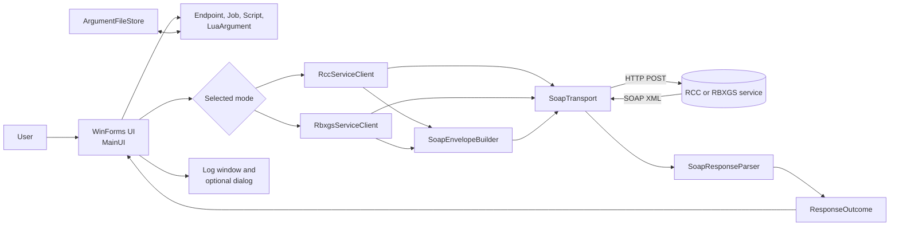

# Architecture

SoapUI is a Windows Forms client for RCC and RBXGS SOAP services. Its main boundaries separate UI state, protocol-specific service clients, SOAP construction, HTTP transport, response parsing, file formats, and domain models.

## At a glance

| Concern | Implementation |
|---|---|
| Application | Windows Forms, .NET Framework 4.7.2, C# 7.3 |
| Entry point | `Program.Main()` starts `UI.MainUI` |
| Service modes | RCC and legacy RBXGS |
| Transport | Synchronous HTTP `POST` using `HttpWebRequest` |
| Payload | SOAP 1.1 XML encoded as UTF-8 |
| Default RCC target | `http://127.0.0.1:64989`, base URL `roblox.com` |
| Release executable | Optimized `SoapUI.exe`; Newtonsoft.Json is embedded |

The Release executable still requires the .NET Framework 4.7.2 runtime. Embedding Newtonsoft.Json removes its sidecar DLL; it does not bundle the framework runtime.[^1]

## System map

The builder creates both shared payload fragments and the outer mode-specific envelope. Clients choose action bodies; the transport owns the HTTP request and returns raw XML.

## Layer boundaries

| Layer | Main files | Responsibility |
|---|---|---|
| Presentation | `UI/MainUI.cs`, `UI/MainUI.Designer.cs` | Read and validate input, create models, dispatch actions, render logs and dialogs |
| Service clients | `Services/Soap/RccServiceClient.cs`, `Services/Soap/RbxgsServiceClient.cs` | Expose typed action methods and construct action-specific body elements |
| SOAP construction | `Services/Soap/SoapEnvelopeBuilder.cs` | Build envelopes and reusable job, script, and Lua argument fragments |
| HTTP transport | `Services/Soap/SoapTransport.cs` | Select URL, set headers and timeout, POST XML, map transport failures |
| Response parsing | `Services/Parsing/SoapResponseParser.cs` | Convert action-specific response XML into `ResponseOutcome` |
| File I/O | `Services/IO/ArgumentFileStore.cs` | Import and export script arguments |
| Domain models | `Models/` | Represent endpoints, service mode, jobs, scripts, arguments, status, and results |
| Shared utilities | `Common/` | Defaults, precondition checks, XML helpers, and time conversion |

The UI acts as the request composition root: it creates the endpoint and request models, selects the client, and later invokes the parser. Lower layers return values or exceptions; they do not show WinForms dialogs.

## Further reading

- [Request lifecycle and error handling](REQUEST-FLOW.md)
- [RCC and RBXGS protocol details](PROTOCOLS.md)
- [Domain models and argument files](DATA-FORMATS.md)
- [Build, packaging, and contributor guidance](DEVELOPMENT.md)

[^1]: The Release configuration embeds Newtonsoft.Json specifically. Framework assemblies are supplied by the installed .NET Framework runtime.