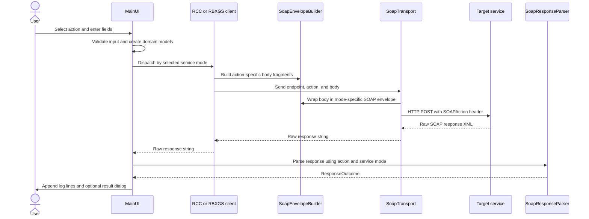
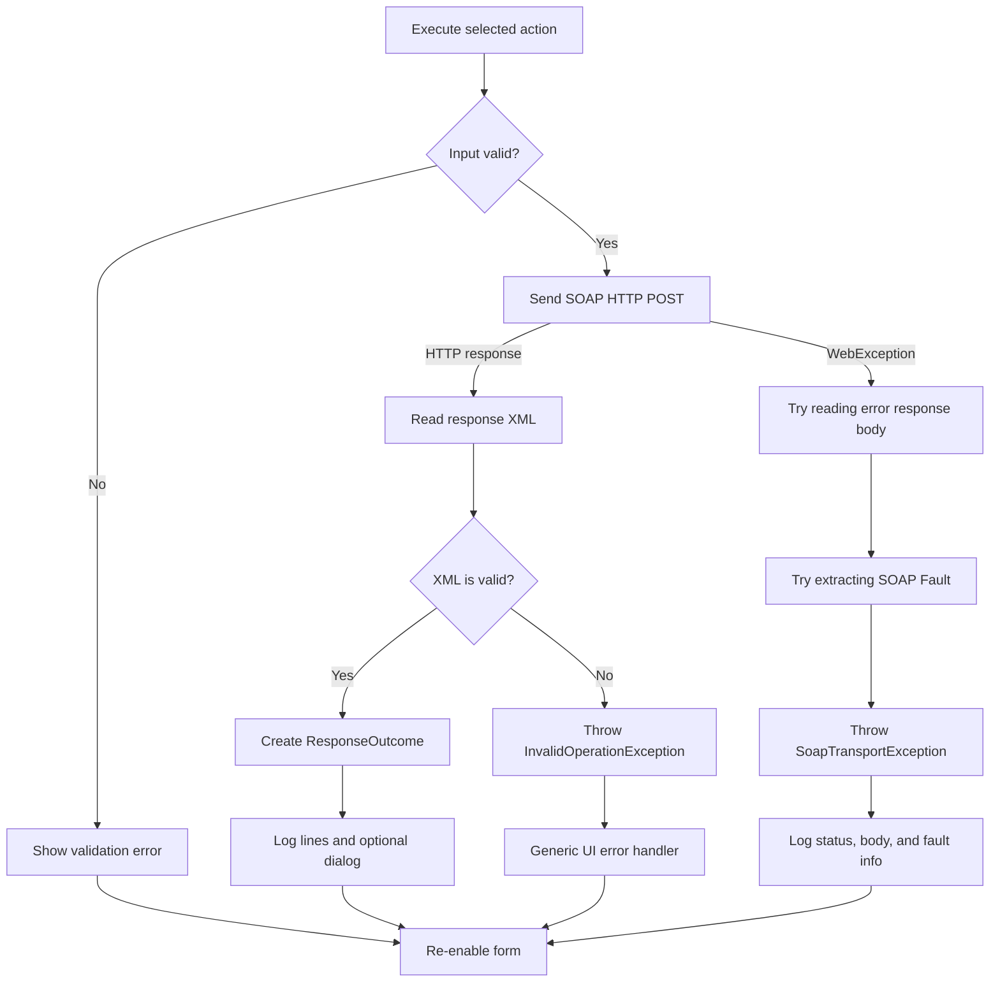

# Request Flow

This page follows an action from the WinForms controls to the service and back. The flow is synchronous: the form disables itself while the request is in progress and is re-enabled in a `finally` block.

## Successful request

## Lifecycle

1. `MainUI` reads the selected action and current `ServiceMode`.
2. It parses numeric fields such as the port, job expiration, and diagnostic type. Invalid values raise an `InvalidOperationException` before a network request is made.
3. The UI creates a `ServiceEndpoint` and, where applicable, `Job`, `Script`, and `LuaArgument` instances.
4. The dispatcher selects `RccServiceClient` or `RbxgsServiceClient`. A typed client method builds the action body and calls `SoapTransport.Send`.
5. The transport chooses the mode-specific URL and envelope, sends UTF-8 XML, and returns the server's response body.
6. The UI passes the response, action, and service mode to `SoapResponseParser`.
7. `ResponseOutcome.LogLines` are appended to the log. A dialog is shown only when `ResponseOutcome.HasDialog` is true.

## Failure paths

### Transport exceptions

`SoapTransport` catches `WebException`, attempts to read the response stream, and searches the XML for a SOAP `Fault`. It throws `SoapTransportException` with:

- The action name and original exception.
- Whether an HTTP response was received and its status code, when available.
- The raw response body, when readable.
- The SOAP fault code and fault string, when parsing succeeds.

The service layer does not display UI. `MainUI` decides what to log and which error dialog to show. Failure to read the body or parse a fault does not replace the original transport exception.

### Parse and presentation outcomes

`SoapResponseParser` rejects blank XML and wraps malformed XML in an `InvalidOperationException`, preserving the `XmlException` as its inner exception. Action-specific parsing may return a result dialog, log-only messages, or a generic success message where full payload decoding is not implemented.

`ResponseOutcome` supports:

- `Info(title, text)` for a dialog result.
- `Silent(logLines)` for log-only results.
- A general constructor combining dialog content and log lines.

## Relevant code

- [UI dispatch and rendering](../UI/MainUI.cs)
- [HTTP transport and transport exception](../Services/Soap/SoapTransport.cs)
- [Response parsing](../Services/Parsing/SoapResponseParser.cs)
- [Response outcome model](../Models/Responses/ResponseOutcome.cs)